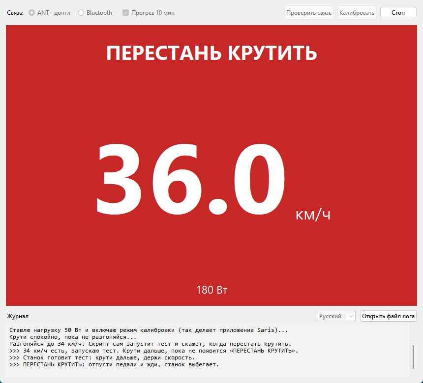
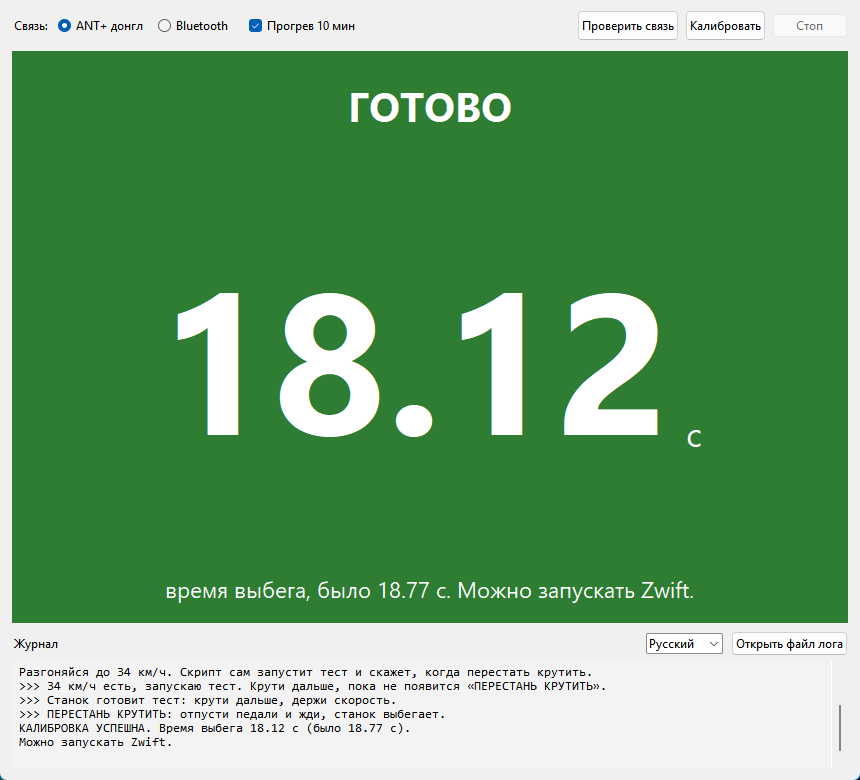

# Калибровка Hammer · Hammer Calibration

[Русский](#русский) · [English](#english)

## Русский

Калибровка (spindown) умного станка Saris / CycleOps Hammer с компьютера на Windows по ANT+ или Bluetooth. Программа крупно показывает скорость и что делать, а перед калибровкой даёт 10 минут прогрева: холодный станок тормозит сильнее, и время выбега выходит другим.

Скачай `HammerCalibration.exe` из [последнего релиза](../../releases/latest) и запусти, установка не нужна. Нужны Windows 10/11 и ANT+ донгл или Bluetooth. Zwift и приложения на телефоне на время калибровки закрой: донгл и Bluetooth станка работают только с одной программой.

 

### Как откалибровать

1. Выбери ANT+ или Bluetooth и нажми **Калибровать**.
2. Прогрейся 10 минут. Если станок уже тёплый, нажми **Калибровать сейчас** или пробел.
3. Разгонись до целевой скорости и держи её, а на красном экране **ПЕРЕСТАНЬ КРУТИТЬ** отпусти педали и жди.
4. Зелёный экран **ГОТОВО** покажет новое время выбега.

**Проверить связь** только показывает данные станка. Язык переключается внизу окна.

### Вопросы

**Какое время выбега правильное?** Число у каждого станка своё, сравнивать его с чужим нет смысла. Важно, чтобы у твоего станка оно не скакало от раза к разу. Поэтому калибруй прогретый станок и всегда одним способом, лучше по ANT+: так станок сам проверяет, что прогрелся.

**Как часто калибровать?** После перевозки станка, когда в комнате заметно поменялась температура, или если мощность кажется странной.

**Не находит станок?** Закрой Zwift, покрути педали, чтобы станок проснулся, выключи Bluetooth на телефоне.

**Калибровка не удалась?** Держи скорость ровно, а после «ПЕРЕСТАНЬ КРУТИТЬ» не трогай педали до конца выбега.

Подробности каждой калибровки пишутся в `hammer log.txt` рядом с программой, его можно приложить к [issue](../../issues). В логе есть серийный номер станка и его Bluetooth-адрес.

### Совместимость

Проверено на Saris Hammer (модель 320, прошивка 31.065). H2 и H3 должны работать так же, но пока не проверялись. Если попробуешь, напиши в [Issues](../../issues), получилось или нет.

### Из исходников

```
pip install -r requirements.txt
python "hammer spindown.py"
```

Ключи: `--info` проверка связи в консоли, `--console` калибровка в консоли, `--ant` / `--ble` выбор связи, `--no-warmup` без прогрева, `--en` / `--ru` язык. Exe собирает `build.bat`, нужен Python 3.12 с python.org.

### Лицензия

MIT. Проект независимый и с Saris не связан. Калибровка та же, что в приложении Saris и в Zwift, но пользуешься программой на свой риск.

## English

Spindown calibration for the Saris / CycleOps Hammer smart trainer from a Windows PC, over ANT+ or Bluetooth. The program shows your speed in large digits and what to do, and gives a 10-minute warm-up before the calibration: a cold trainer has more drag and gives a different spindown time.

Download `HammerCalibration.exe` from the [latest release](../../releases/latest) and run it, no installation needed. You need Windows 10/11 and an ANT+ dongle or Bluetooth. Close Zwift and the apps on your phone while calibrating: the dongle and the trainer's Bluetooth work with one program at a time.

 

### How to calibrate

1. Choose ANT+ or Bluetooth and click **Calibrate**.
2. Warm up for 10 minutes. If the trainer is already warm, click **Calibrate now** or press Space.
3. Speed up to the target speed and hold it, and on the red **STOP PEDALING** screen let go of the pedals and wait. Speed is shown in km/h: the target is usually 32–34 km/h, about 20–21 mph.
4. The green **DONE** screen shows the new spindown time.

**Check connection** only shows the trainer's data. The language switch is at the bottom of the window.

### FAQ

**What spindown time is right?** Every trainer has its own number, so comparing yours with someone else's makes no sense. What matters is that your trainer's number stays steady from one calibration to the next. So calibrate a warm trainer and always the same way, preferably over ANT+: then the trainer checks for itself that it has warmed up.

**How often should I calibrate?** After moving the trainer, when the room temperature has changed noticeably, or when the power seems off.

**Trainer not found?** Close Zwift, turn the pedals to wake the trainer up, turn off Bluetooth on your phone.

**Calibration failed?** Hold the speed steady, and after "STOP PEDALING" don't touch the pedals until the spindown ends.

Each calibration is logged in `hammer log.txt` next to the program, and you can attach it to an [issue](../../issues). The log contains the trainer's serial number and Bluetooth address.

### Compatibility

Tested on a Saris Hammer (model 320, firmware 31.065). The H2 and H3 should work the same way but have not been tested yet. If you try one, please report in [Issues](../../issues) whether it worked.

### From source

```
pip install -r requirements.txt
python "hammer spindown.py"
```

Options: `--info` check the connection in the console, `--console` calibrate in the console, `--ant` / `--ble` choose the connection, `--no-warmup` skip the warm-up, `--en` / `--ru` language. `build.bat` builds the exe and needs Python 3.12 from python.org.

### License

MIT. This is an independent project, not affiliated with Saris. It runs the same calibration as the Saris app and Zwift, but you use it at your own risk.
